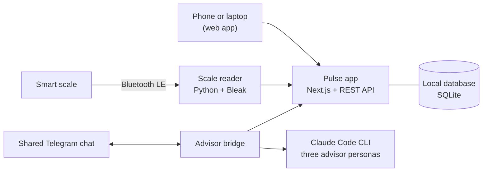

# Pulse

> **This is a showcase. The source code is private.**
> It is a personal tool built around one person's life, so the code and the data stay private. This page explains what I built and how.

Pulse is a personal fitness and nutrition companion that runs on a small computer at home. Nothing about the body, the food or the workouts it tracks ever leaves the house.

## The idea

One honest, private record of fitness and nutrition, with friendly ways to add to it and to see how things are going.

- **It never shows made-up numbers.** If there is no data yet, it says so.
- **One person, one home server.** Self-hosted on purpose.
- **It talks back.** Three AI advisors live in a shared chat and can read the same record the app uses.

## A look

Screens from the design study for the workouts side of the app. Every number on them is a sample, and the real app shows only real data.

## The advisors: a conversation I can have at any moment

Pulse is not only an app. The same record is wired to three AI advisors that live in one shared Telegram chat, so I can talk to them any time, from anywhere, the way I would message a person.

- **One chat, three voices.** A nutritionist, a fitness coach and a chef share a single conversation. The right one answers, and the chef speaks only when I ask for a recipe or food ideas.
- **I can send them things.** A photo of a nutrition label or a plate, a PDF, a Word, Excel or CSV file, or a Google Sheet link goes straight into the chat. The advisor reads it (text is extracted, images go through vision), answers, saves the useful facts, and the downloaded file is deleted afterwards.
- **The app and the advisors share one record.** If I photograph a label inside the app, the entry is saved as "waiting for the advisor" with no invented numbers. The advisor reads what is printed, never guesses what is not, and writes the result back to the same record. In the other direction, every time I write in the chat, the bridge first hands the advisor a fresh brief of my current data, so the answer is based on what is really there.
- **They pass things to each other.** Advisors can leave hand-offs addressed to one another, and they all read the same shared memory, so I do not have to repeat myself to each of them.
- **They remember, and they learn me.** Facts from conversations and uploads are saved, with a timestamp, the source and the advisor, into a shared memory that is part of every prompt. The notes on nutrition and training keep growing as we talk, so the advice gets more specific the longer I use it.
- **Writes are gated, and honesty is a hard rule.** What an advisor adds to the app goes through a controlled action path, not free access to the database. A rule in every prompt forbids inventing numbers, files or buttons: if an advisor cannot open something, it says so.

## What it does

| Screen | What it is for |
| --- | --- |
| Home | A calm daily summary |
| Body | Weight, body composition and measurements, with trends from a week to six months and an editable history |
| Nutrition | A food journal with a personal food bank, barcode scanning, and calories and macros shown in clear colours |
| Water | A daily goal with one-tap quick adds |
| Workouts | A journal of exercises, logged set by set |
| Progress | The training block, records and progress per exercise |
| Backup and data | Bring data in, take it out, keep a safe copy |

## How it is put together

- **The app** is the single source of truth. A small local database sits behind a REST API that every other piece talks to.
- **The scale reader** talks to the scale directly over Bluetooth LE, so measurements never pass through the maker's cloud. The app works out body composition itself.
- **The advisors** are three personas (a nutritionist, a fitness coach and a chef) in one shared chat. The bridge reads the current record once per turn and puts a short brief into the prompt, and anything they write back goes through a gated action path. If the key between the pieces is missing, the whole path fails closed and the advisors see nothing rather than guessing.
- **The plumbing** is Docker Compose, a reverse proxy and a private network, so it is reachable only by the person it belongs to.

## Decisions I am proud of

- **Fail closed.** A missing key means no data, never partial data.
- **Honest empty states.** No placeholder numbers anywhere.
- **Time zones in one place.** What counts as "today" is a single setting, so no corner of the system can quietly disagree about what day it is.
- **A design language, written down.** Light, warm, one accent colour, and a checklist every screen has to pass on four screen sizes before it is called done.

## How it is built

Pulse is built with a team of AI agents. A main "conductor" session stays light and hands the real work to specialist agents: one plans and prioritises, builders build, a QA gate verifies against a production build, a security gate reviews anything that touches data or secrets, and a documentation keeper keeps the written record honest. Nothing ships on a failed gate, and every release leaves a restore point behind.

## Stack

Next.js, TypeScript, SQLite, Python, Bleak (Bluetooth LE), Docker Compose, Caddy, Tailscale, Telegram, Claude Code.

## Status

In daily use. Screenshots are not included here because the real app shows real personal data.
