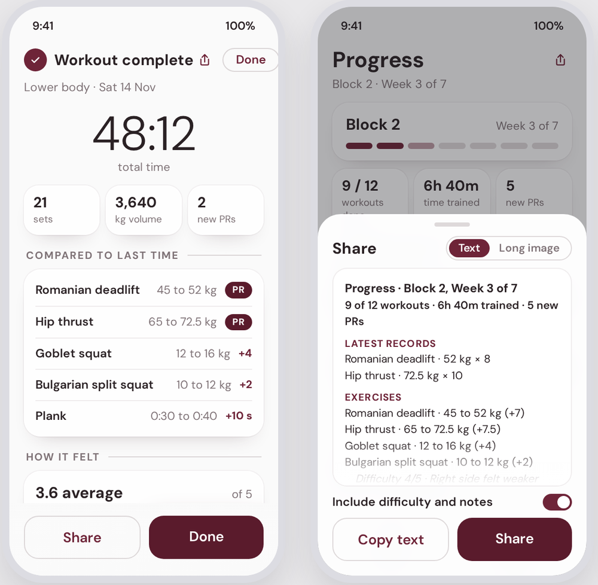

<h1 align="center">Pulse</h1>

<b>A fitness and nutrition tracker that lives on a small computer in my home, with three advisors I can message any time.</b>

> **This is a showcase.** The source code is private, because Pulse is built around one person's life. Here is what it does and how it fits together.

Weight, food, water, workouts: it all goes in one place, and none of it leaves the house. Then, in the same Telegram chat where I message friends, a nutritionist, a fitness coach and a chef answer questions about that data.

## Three advisors, one chat

I write to them the way I would write to a person, at any hour. The right one answers. The chef stays quiet unless I ask for a recipe or food ideas.

## Send them whatever is in front of you

A photo of a nutrition label, a picture of my plate, a PDF, a spreadsheet, a Google Sheet link. The advisor reads it, answers, and saves what is worth keeping. I never retype numbers.

## They already know me

Everything I share goes into a memory that all three advisors read before they answer, so I do not explain myself twice. The more I use Pulse, the more specific their advice gets.

The app and the advisors also work on the same record. Photograph a label inside the app and an advisor reads it and writes the result back. Ask something in the chat and the advisor first looks at my current numbers, so the answer is based on what is really there.

## The app

| | |
| --- | --- |
| **Body** | Weight, composition and measurements, with trends from one week to six months |
| **Nutrition** | A food journal with my own food bank, barcode scanning, and calories and macros in clear colour |
| **Water** | A daily goal, one tap per glass |
| **Workouts** | Every exercise, set by set |
| **Progress** | The training block, my records, and how each lift is moving |
| **Backup** | Data in, data out, and a safe copy |

One rule runs through all of it: **Pulse never shows a made-up number.** If there is no data yet, it says so. The same rule is written into every advisor's instructions, along with a ban on inventing files or buttons.

## A look

Screens from the design study for the workouts side of the app. Every number on them is a sample, and the real app shows only real data.

## Private on purpose

Pulse runs on a small computer at home. My weight, my food and my workouts stay there. If a piece is missing, Pulse stays quiet instead of guessing.

## How I built it

With a team of AI agents: one plans, others build, one tests, one reviews security, one keeps the written record honest. I am the human in the loop who decides. Nothing goes live until it passes the checks, and every release leaves a restore point behind.

## Want to see it work?

The code stays private, but I am happy to show you Pulse live and explain how the pieces fit.

Built by <a href="https://github.com/einavtayari">Einav</a>, the human in the loop.

