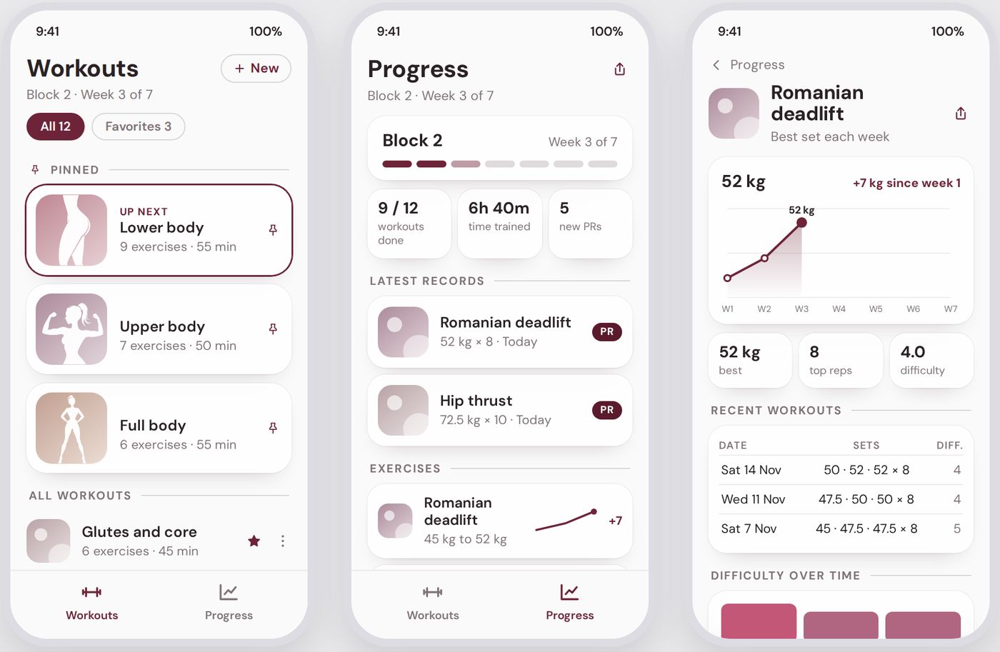

<h1 align="center">Pulse</h1>

<b>A fitness and nutrition companion that is yours alone.</b> Your body, your food, your training, and three AI advisors who actually know you.

> **A showcase.** The source code is private, because Pulse is built around one person's life. This page tells the story.

## Meet your team

What if a nutritionist, a fitness coach and a chef lived in your chat?

That is Pulse. Three advisors share one Telegram conversation, so you can talk to them at any moment, from anywhere, the way you would message a friend. The right one answers. The chef steps in only when you ask for a recipe or food ideas.

## Send them anything

Snap a nutrition label. Photograph your plate. Drop in a PDF, a spreadsheet or a Google Sheet link. They read it, answer you, and quietly save what matters. No retyping, no copying numbers by hand.

## They remember you, and they get better at it

Everything you share goes into a memory that all the advisors read before they answer. The longer you use Pulse, the more specific the advice becomes, and you never have to repeat yourself to each of them.

The advisors and the app also work as one. Photograph a label inside the app and an advisor reads it and writes the result back. Ask a question in the chat and the advisor first looks at your real, current data.

## One honest place for all of it

| | |
| --- | --- |
| **Body** | Weight, composition and measurements, with trends from a week to six months |
| **Nutrition** | A food journal with your own food bank, barcode scanning, and calories and macros in clear colour |
| **Water** | A daily goal, one tap to add a glass |
| **Workouts** | Every exercise, set by set |
| **Progress** | Your training block, your records, and how each lift is moving |
| **Backup** | Your data in, your data out, and always a safe copy |

And the rule behind all of it: **Pulse never shows a made-up number.** No data yet? It says so.

## A look

Screens from the design study for the workouts side of the app. Every number on them is a sample, and the real app shows only real data.

## Private by design

Pulse runs on a small computer at home. Nothing about your body, your food or your workouts ever leaves the house. If anything is missing, it stays quiet instead of guessing.

## How it is made

Pulse is built by a human in the loop and a team of AI agents: planners, builders, testers, a security reviewer and a keeper of the written record. Nothing ships until it passes the gates, and every release leaves a restore point behind.

## Want to see it live?

The code is private, but I am glad to walk you through how Pulse works, in a demo or a conversation.

Built by <a href="https://github.com/einavtayari">Einav</a>, the human in the loop.

